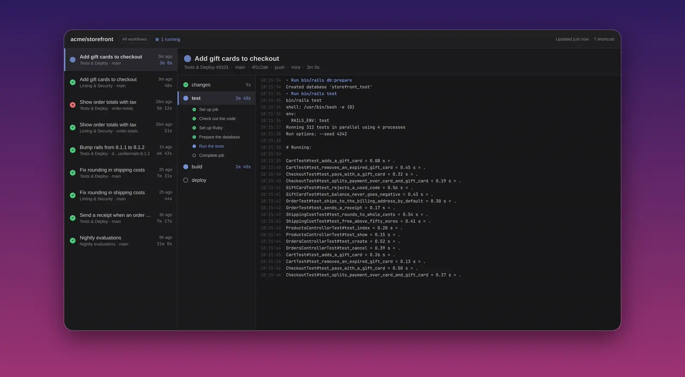
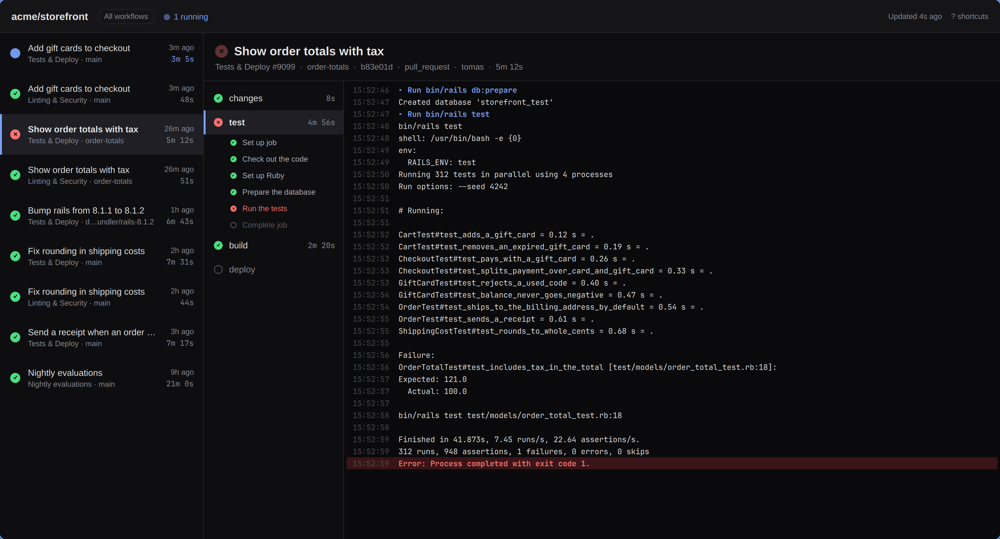

# CI Watch for Omarchy



The GitHub Actions of one repository, live, in a window of their own. The runs on the left, the jobs and steps of the one you picked in the middle, and its log on the right, growing at the bottom while the job is still running.

A bar widget can tell you that a build is red. It cannot tell you why, and finding out means a browser tab, three clicks into GitHub's Actions page, and a log viewer that loads a few thousand lines into a web page and scrolls them like one. This is the other half: open the build and the failing job is already selected, with the log scrolled to the first error.

It is a native Qt Quick app, built and installed the way Omarchy's own apps are. New lines slide into the log and the view glides along with them, the running dots pulse, and the accent follows your Omarchy theme as you switch it.

## Install

```bash
git clone https://github.com/jankeesvw/ciwatch.git
cd ciwatch
bin/install
```

That builds the app and installs it as an Arch package with `makepkg -fsi`, so it shows up in the app launcher as CI Watch, with its own icon. It asks for your password once, for the `pacman -U` at the end.

## Requirements

Omarchy, which already ships everything the build needs: Qt 6, `qmake6` and a compiler. And the [`gh` CLI](https://cli.github.com), logged in with `gh auth login`. Every request goes through it, so CI Watch never sees or stores a token, and private repositories work exactly as far as your `gh` login can see them. A `gh` installed through mise is found too, also when the launcher starts the app without your shell's `PATH`.

## Which repository

```bash
ciwatch                                  # wbso-ai/application, the one I watch
ciwatch basecamp/omarchy                 # any other
ciwatch basecamp/omarchy --sha 4f1c2ab   # only the runs of one commit
```

There is only ever one window. Starting it again while it is open hands the repository and commit over to that window and brings it to the front, rather than opening a second one next to it.

## With GitHub Build Monitor

The [GitHub Build Monitor](https://github.com/jankeesvw/omarchy-github-build-monitor) bar widget opens a build here when you press Enter on it, as long as CI Watch is installed. You get the runs of that commit, with the one that failed or is still going selected. `g` in the widget still opens the build on GitHub.

## Reading the window



| | |
|---|---|
| Pulsing dot | running |
| Open circle | queued, or skipped when it is grey |
| Green check | passed |
| Red cross | failed, timed out, or never started |
| Grey dash | cancelled, which is what GitHub does to a run a newer push replaced |

Pick a run and the job worth looking at is already selected: the one that failed, otherwise the one that is running, otherwise the last one that did any work. While a run is going, the selection moves along to whichever job is running now, until you pick one yourself.

In the log, groups are in the accent colour, commands are blue, warnings yellow and errors red. A failed job opens on its first error, and `E` walks to the next one.

Runs that were skipped are hidden, because a repository with an issue bot has more of those than builds. `S` shows them.

## Following a running build

While anything is running, CI Watch asks GitHub every 6 seconds; when everything is done, once a minute, and right away when you press `Space`, `R` or `Ctrl+R`. The log of a running job is fetched again on every poll, and when it only grew, the new lines are added to the bottom rather than the whole log being replaced, so the view keeps its place.

It follows the end as long as you are at the end. Scroll up to read something and it stops, and a button in the corner says `End` brings it back. Scroll back down to the bottom and it follows again.

GitHub only publishes a job's log once the runner has uploaded the first part of it, so a job that just started shows its steps for a few seconds before it has a log.

When a run you saw running finishes, you get a desktop notification saying whether it passed. Runs that were already done when the window opened stay quiet.

## Keyboard

| Key | Does |
| --- | --- |
| `J` / `↓` | next run |
| `K` / `↑` | previous run |
| `L` / `→` / `Tab` | next job |
| `H` / `←` / `Shift+Tab` | previous job |
| `E` | next error in the log |
| `PgUp` / `PgDn` | scroll the log |
| `Home` / `End` | top of the log / back to following the end |
| `C` | copy the log |
| `O` / `Enter` | open the job on GitHub |
| `F` | cycle through the workflows, one at a time |
| `S` | show or hide skipped runs |
| `Esc` | back to all runs after opening one commit |
| `Space` / `R` / `Ctrl+R` | refresh now |
| `?` | every shortcut, in the window |
| `Q` | quit |

## What it costs

Three requests a poll while something runs (the runs, the jobs of the selected run, and the log of the selected job), so around 1800 an hour, and one request a minute when nothing does. A finished run's jobs and log are fetched once and not again. GitHub allows 5000 requests an hour per user, shared with everything else that uses your `gh` login.

## Privacy

Nothing is written to disk. Runs, jobs and logs live in memory while the window is open and are gone when it closes. The only things that leave the app are the `gh api` calls to GitHub and a `notify-send` when a run finishes. Log lines are drawn as plain text, so nothing in a log can make the window load anything.

## Trying it without GitHub

```bash
ciwatch --demo
```

Invented runs for an invented `acme/storefront`: a build running with a log that grows, one that failed, and a few that passed. The screenshots above are that.

## Building

```bash
bin/build     # build/ciwatch
bin/test      # the Qt tests, offscreen
bin/install   # build/ciwatch, as a package
```

## Removing

```bash
sudo pacman -R ciwatch
```

## License

MIT. The way the app is put together, and the class that follows the Omarchy theme, come from [Omacut](https://github.com/omacom-io/omacut) and [Monologue](https://github.com/omacom/monologue), copyright David Heinemeier Hansson, released under the MIT License.
